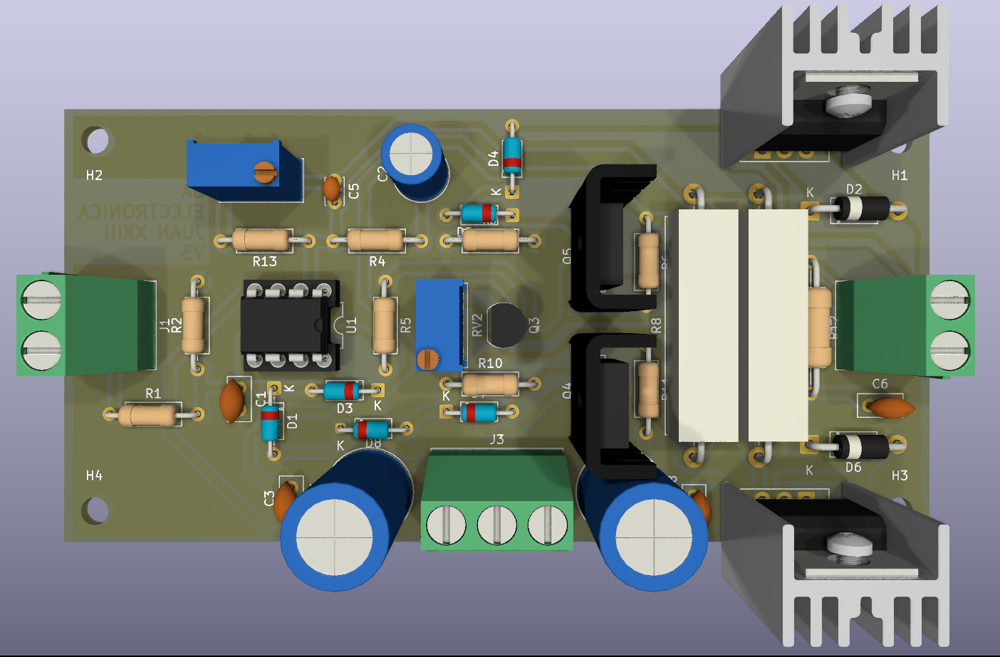
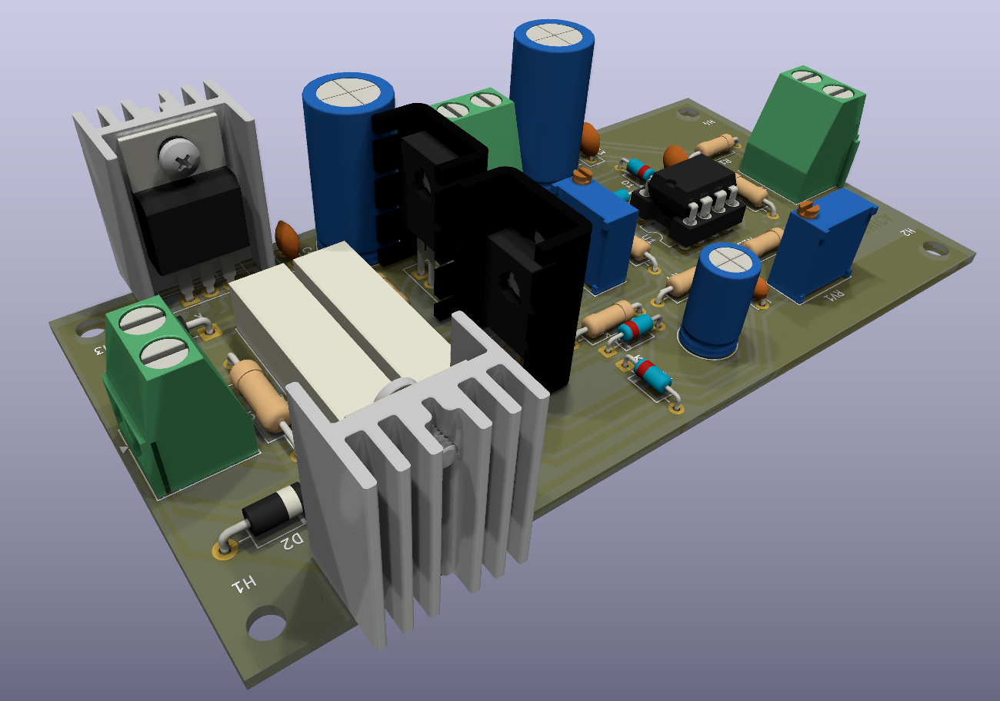
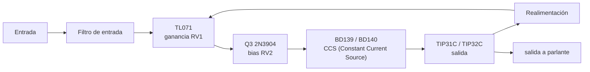
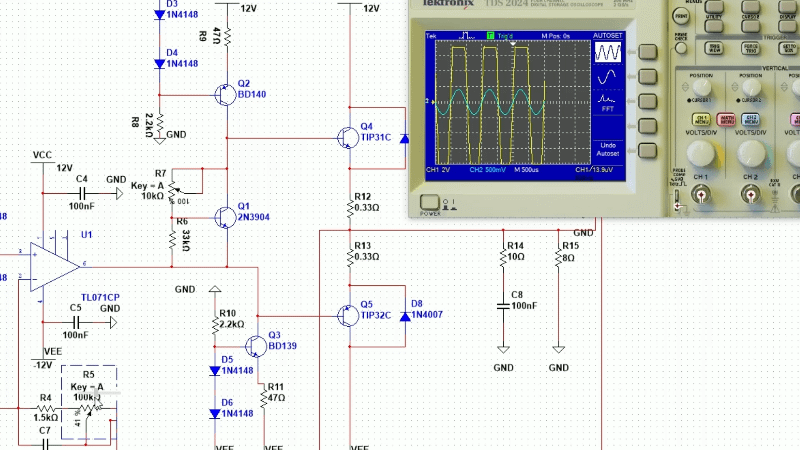

# Amplificador AB

[← Volver al README principal](../../readme.md)

Etapa de potencia **clase AB** . Se usa dos veces, una por canal, para formar el JBR estéreo.

| Vista superior | Vista inferior |
|---|---|
|  |  |

## Ficha técnica

| Parámetro | Valor |
|---|---|
| Potencia de salida | **12 W RMS @ 8 Ω** |
| Alimentación | ±12 a ±17 VDC |
| Etapa de entrada | [TL071](../datasheet/TL071.pdf) (DIP‑8, con zócalo) |
| Excitación / BIAS | [2N3904](../datasheet/2N3904.pdf) |
| CCS | [BD139](../datasheet/BD13X.pdf) (NPN) / [BD140](../datasheet/BD13X.pdf) (PNP) |
| Transistores de salida | [TIP31C](../datasheet/TIP31C.pdf) (NPN) / [TIP32C](../datasheet/TIP32C.pdf) (PNP) |
| Ganancia | 2× a ≈ 69× (6 a 37 dB), ajustable con `RV1` |

## Diagrama en bloques

## Ajustes 🔧

### 1. Corriente de reposo (BIAS)

1. Conectar la placa a la fuente y dejar el **ingreso de audio desconectado**.
2. Esperar unos minutos hasta que el disipador esté a temperatura de trabajo.
3. Medir la tensión continua sobre `R8` y sobre `R9` (0,33 Ω).
4. Ajustar `RV2` hasta obtener **10–15 mV** en cada una (≈ 30–45 mA por par de salida).
5. Verificar que el valor se mantenga estable y que los transistores no se calienten en exceso sin señal.

> [!CAUTION]
> No ajustar el bias con el amplificador entregando potencia, medir con el [TL071](../datasheet/TL071.pdf) desconectado o en su defecto sin entrada.

### 2. Ganancia

`RV1` permite adaptar la sensibilidad de la etapa:

| Ajuste de `RV1` | Ganancia aproximada | En dB |
|---|---|---|
| 0 Ω | 2× | 6 dB |
| 12 kΩ | 10× | 20 dB |
| 100 kΩ | 69× | 37 dB |

Ajustar con una señal senoidal y un osciloscopio, buscando el punto justo antes del recorte.
 

## Simulación 🖥️

Antes de armar la placa, el comportamiento del AB se puede probar en **Multisim 14** con el modelo [`Simulation.ms14`](../../Simulacion/Simulation.ms14). Sirve para verificar el bias, la ganancia y las formas de onda sin arriesgar componentes. El procedimiento y las capturas están en la [documentación de la simulación](simulation.md).

## Consideraciones térmicas 🔥

- `Q1`/`Q2` (TO‑220) deben montarse sobre disipador con grasa térmica.
- `Q4`/`Q5` (TO‑126) también necesitan disipador; la BOM incluye dos disipadores TO‑126.
- Si el disipador está unido eléctricamente al chasis, usar aislantes de mica o almohadillas de silicona y arandelas aislantes.
- No cubrir las aletas del disipador: el equipo disipa potencia incluso en reposo.

## Documentación

| Documento | Archivo |
|---|---|
| Esquemático | [ABSchem.pdf](../PDF/Schem/ABSchem.pdf) |
| Serigrafía | [ABSilk.pdf](../PDF/Transferencia/AB/ABSilk.pdf) |
| Cobre inferior (espejado) | [ABBc.pdf](../PDF/Transferencia/AB/ABBc.pdf) |
| Hoja de datos TL071 | [TL071.pdf](../datasheet/TL071.pdf) |
| Hoja de datos 2N3904 | [2N3904.pdf](../datasheet/2N3904.pdf) |
| Hoja de datos TIP31C | [TIP31C.pdf](../datasheet/TIP31C.pdf) |
| Hoja de datos TIP32C | [TIP32C.pdf](../datasheet/TIP32C.pdf) |
| Hoja de datos BD139/BD140 | [BD13X.pdf](../datasheet/BD13X.pdf) |
| **BOM (Excel)** | [BOM.xlsx](../BOM.xlsx) (hoja 3) |
| Proyecto **KiCad** | [`AB v2/AB.kicad_pro`](<../../AB/AB.kicad_pro>) |
