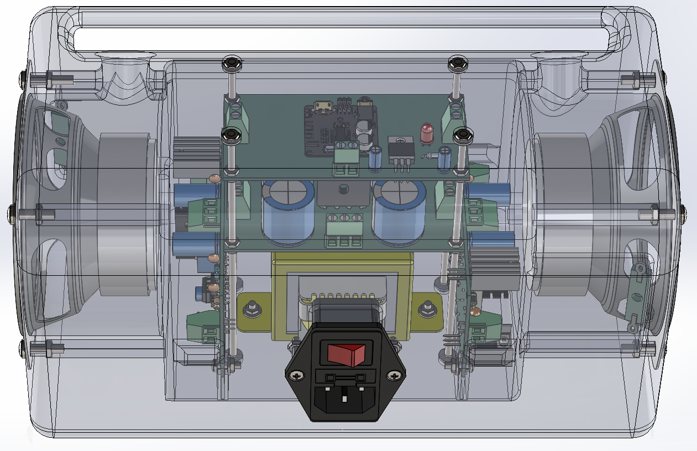
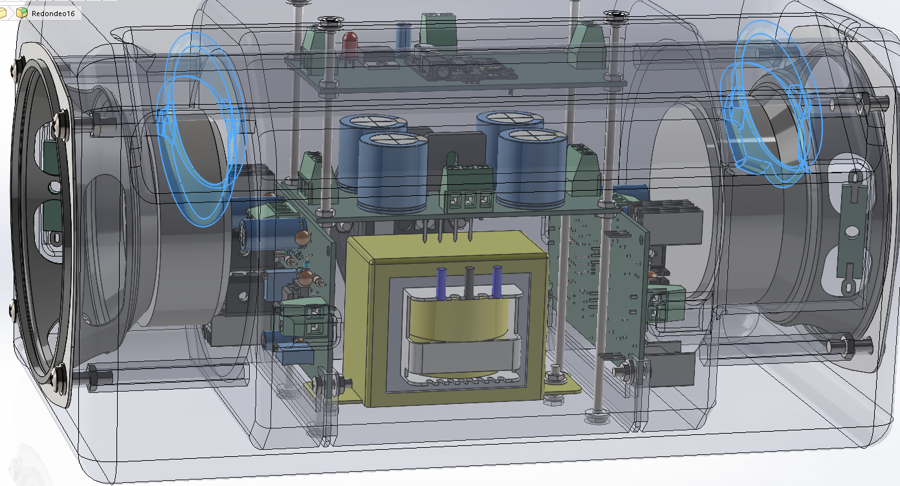
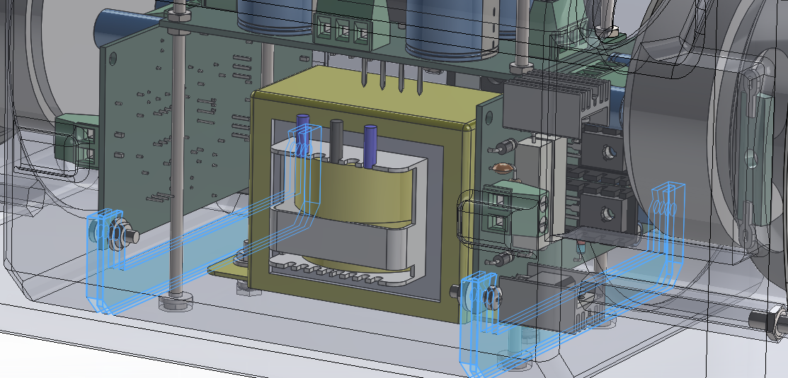
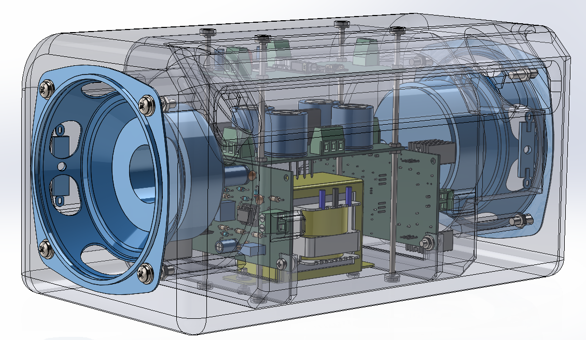
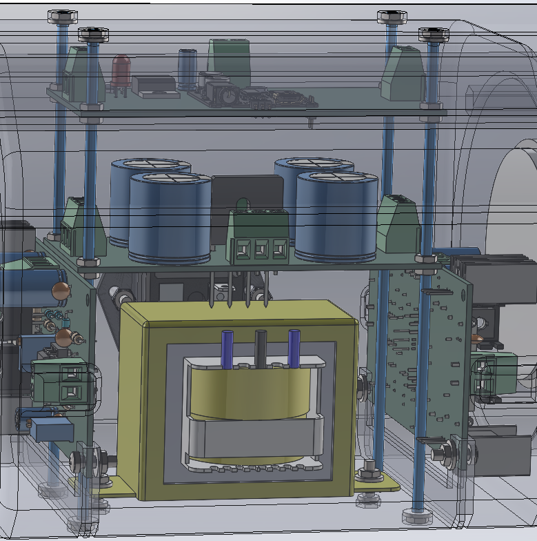
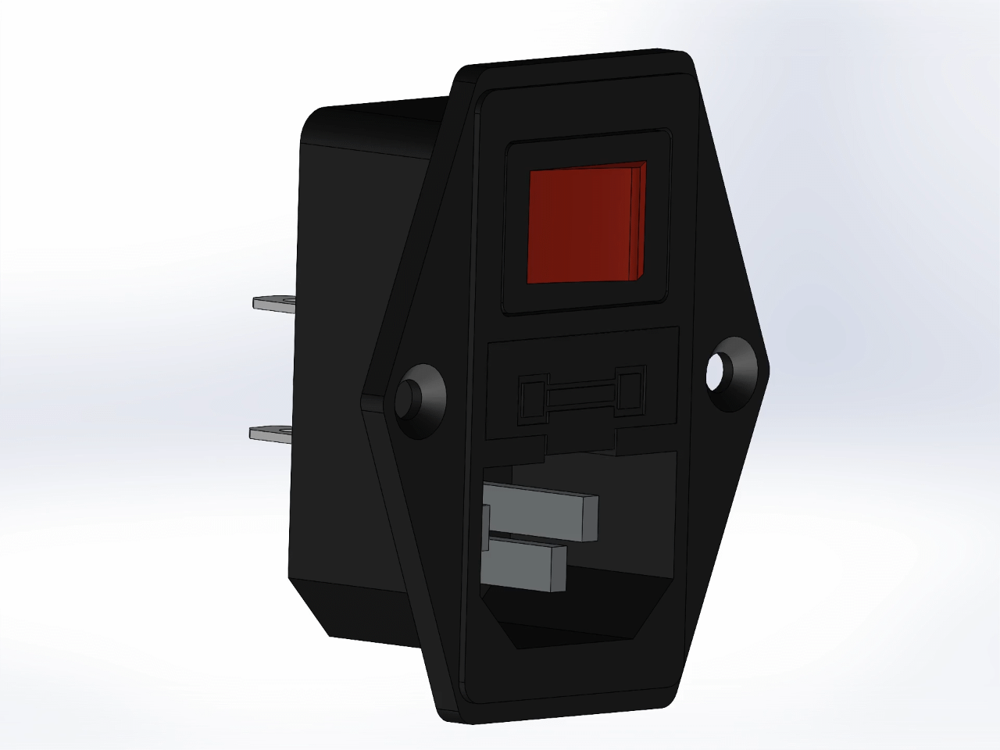
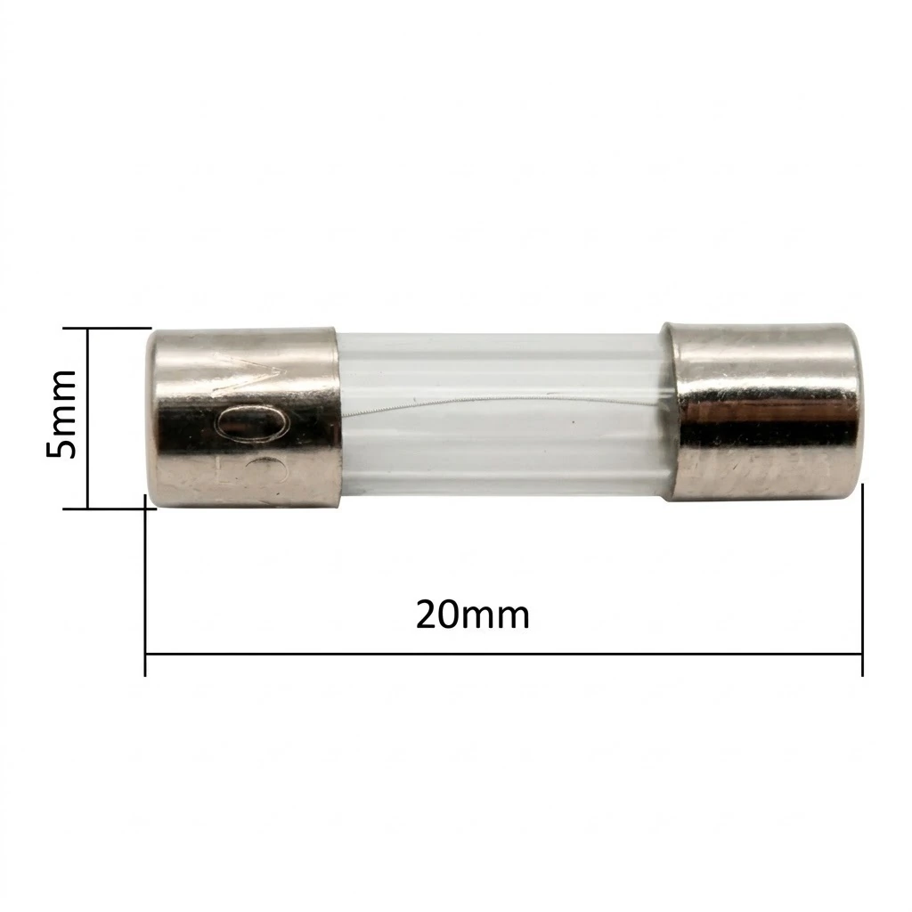

# Gabinete y armado mecánico

[← Volver al README principal](../../readme.md)

Gabinete del parlante JBR, modelado en **SolidWorks** e impreso en 3D. Aloja las tres placas, el transformador, los dos parlantes y la ficha de red con fusible.

## Ventilación y circulación de aire

El gabinete tiene **orificios de ventilación** en la parte superior y en el panel de entrada de aire. Estos agujeros cumplen dos funciones: permiten que los parlantes **tomen y saquen aire** al moverse y, al mismo tiempo, dejan entrar aire fresco para **disipar el calor** del transformador y de las etapas de potencia.

Conviene mantener las rejillas libres y no apoyar el equipo sobre superficies blandas, para que el aire pueda circular.

## Anclaje de las placas AB

Los dos [**AB**](ab.md) se fijan a los soportes internos del gabinete con **tornillos M3 × 10 mm y tuercas M3**. Son los mismos M3 que figuran en la hoja de herrajes de la BOM.

Cada placa se apoya sobre sus separadores y se atornilla desde el lado del soporte, dejando la electrónica accesible para poder desmontarla sin sacar el transformador.

## Parlantes

El equipo lleva **dos parlantes de 4″ de 8 Ω y 30 W RMS**. Se sujetan al bafle con **tornillos M4 × 16 mm, tuercas M4 y arandelas M4**

Antes de atornillarlos, verificar que la junta o el sellado apoyen bien sobre el bafle para evitar pérdidas de aire y vibraciones.

## Varillas de unión

Las varillas roscadas de 1/8″ unen las piezas principales del gabinete y se ajustan con sus tuercas y arandelas. Además, sostienen la [Fuente](fuente.md) y [Control](control.md), que quedan ancladas al conjunto.

## Cambio de fusible

El fusible de red está en la **ficha C14** del panel trasero, dentro de su porta fusible. Es de **250 V, 5 A, 5 × 20 mm**.

| Secuencia de cambio | Detalle del porta fusible |
|---|---|
|  |  |

Para cambiarlo: apagar y desconectar el equipo de la red, abrir el porta fusible, extraer el fusible y reemplazarlo por otro del **mismo valor y tipo**.

> [!IMPORTANT]
> Reemplazar el fusible solo con el equipo **desconectado de la red**. Si vuelve a quemarse, no insistir: hay una falla que debe revisar un técnico.

## Dimensiones

| Parámetro | Valor |
|---|---|
| Ancho × alto × profundidad | **270 × 140 × 135 mm** |

> [!CAUTION]
> La ficha C14 y el cable C13 manejan 220 V. El armado eléctrico debe quedar aislado y sin partes accesibles. Si el gabinete es de PLA, no reemplaza el aislamiento de las conexiones: usar terminales, tubo termocontraíble.

## Documentación

| Documento | Archivo |
|---|---|
| Piezas para impresión 3D | [Arriba.STL](<../../gabinete/Impresion 3D/stl/arriba.STL>) · [Abajo.STL](<../../gabinete/Impresion 3D/stl/abajo.STL>) |
| Proyecto **SolidWorks** | [Gabinete.SLDASM](../../gabinete/Gabinete.SLDASM) |
| **BOM (Excel)** | [BOM.xlsx](../BOM.xlsx) (hojas 1 y 5) |
