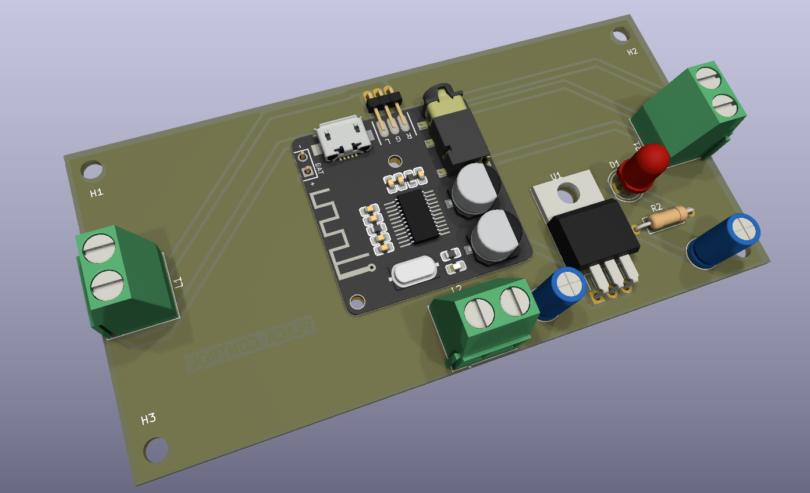
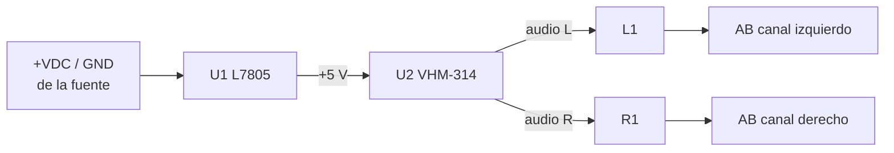
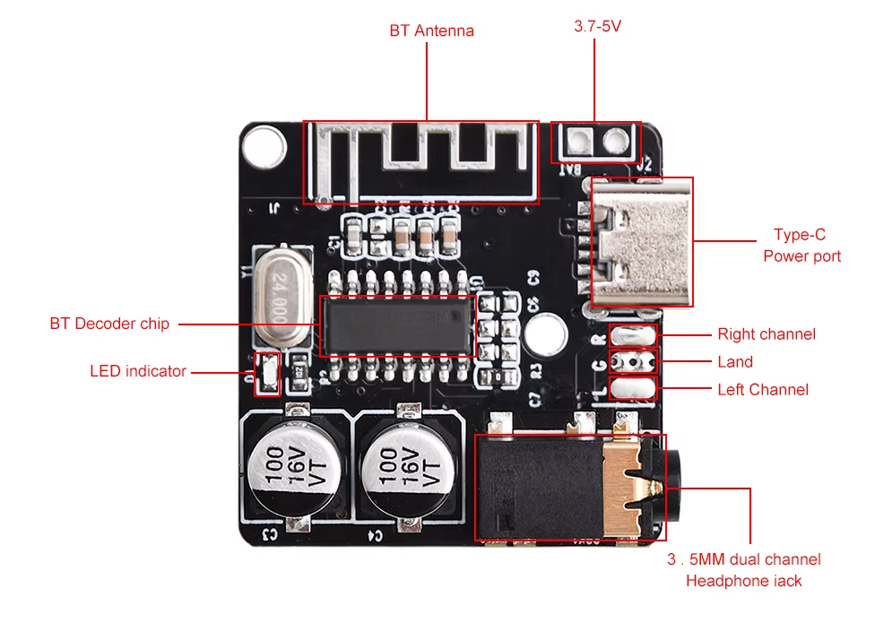

# Placa de control 📡

[← Volver al README principal](../../readme.md)

la placa de control toma **12–16 VDC** de una de las salidas de la fuente y los regula a **5 V** mediante el **[L7805](../datasheet/L7805.pdf)**. Esos 5 V alimentan el módulo Bluetooth **[VHM‑314](../datasheet/VHM-314.pdf)**, que recibe el audio inalámbrico y lo entrega como canales **izquierdo** y **derecho** por `L1` y `R1` hacia las etapas **AB**.

## Ficha técnica

| Parámetro | Valor |
|---|---|
| Alimentación | 12–16 VDC (desde una salida de la fuente) |
| Regulador | [L7805](../datasheet/L7805.pdf) (salida 5 V) |
| Bluetooth | 5.0, módulo [VHM‑314](../datasheet/VHM-314.pdf) |
| Entradas/salidas | `L2` alimentación, `L1` audio izquierdo, `R1` audio derecho |

## Diagrama en bloques

## Módulo Bluetooth

Para vincular el modulo busque el nombre `HFW-BT` en su dispositivo (el nombre puede variar dependiendo la version del modulo)

> [!IMPORTANT]
> * La placa no incluye filtro de audio ni control de volumen: el volumen se maneja desde el dispositivo Bluetooth.
> * El LED indica solamente que llega alimentación a la placa; **no informa el estado de la vinculación Bluetooth.**

## Documentación

| Documento | Archivo |
|---|---|
| Esquemático | [ControlSchem.pdf](../PDF/Schem/ControlSchem.pdf) |
| Serigrafía | [ControlSilk.pdf](../PDF/Transferencia/Control/ControlSilk.pdf) |
| Cobre inferior (espejado) | [ControlBc.pdf](../PDF/Transferencia/Control/ControlBc.pdf) |
| Hoja de datos L7805 | [L7805.pdf](../datasheet/L7805.pdf) |
| Hoja de datos VHM‑314 | [VHM-314.pdf](../datasheet/VHM-314.pdf) |
| **BOM (Excel)** | [BOM.xlsx](../BOM.xlsx) (hoja 4) |
| Proyecto **KiCad** | [`Control/Control.kicad_pro`](../../Control/Control.kicad_pro) |
