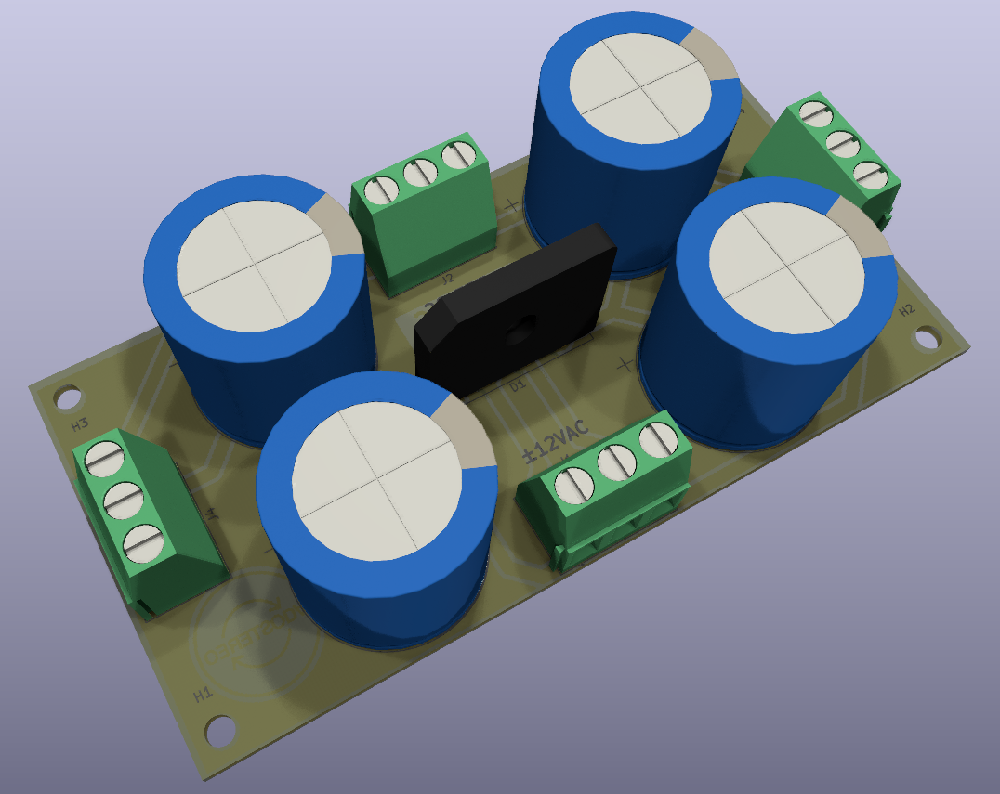

# Fuente simétrica ⚡

[← Volver al README principal](../../readme.md)

Fuente lineal para el amplificador. Rectifica un transformador con secundario **12‑0‑12 VAC** (con punto medio) y entrega rieles positivo y negativo filtrados, con **tres salidas en paralelo** para las placas del equipo.

## Ficha técnica

| Parámetro | Valor |
|---|---|
| Entrada | 12‑0‑12 VAC, 3 hilos con punto medio |
| Salidas | 3 × (+VDC / GND / −VDC)|
| Tensión de salida | ≈ ±16 VDC sin carga; ≈ ±15 VDC a plena carga |
| Rectificación | Puente GBU6G |
| Filtrado | 4 × 6800 µF / 50 V → **13,6 mF por riel** |

## Filtrado y rizado

El rizado pico a pico se estima con:

$$\Delta V \approx \frac{I}{2 \cdot f_{red} \cdot C}$$

Con `C = 13,6 mF` por riel y `f_red = 50 Hz`:

| Corriente por riel | Rizado teórico |
|---|---|
| 0,5 A | ≈ 0,37 V p‑p |
| 1 A | ≈ 0,74 V p‑p |
| 1,5 A | ≈ 1,10 V p‑p |
| 2 A | ≈ 1,47 V p‑p |

> El valor real es algo mayor por la resistencia serie de los capacitores, la caída del puente y la tolerancia de los componentes. Para uso musical normal, el rizado es aceptable.

## Transformador sugerido

- Primario: **220 VAC**, 50/60 Hz.
- Secundario: **12 V + 12 V AC** con punto medio (12‑0‑12 VAC).
- Corriente: **≥ 2 A** (≈ 48 VA). Para uso continuo en estéreo se recomienda **3 A o más** (≈ 72 VA).

> [!CAUTION]
> **Precaución:** No manipular la placa energizada, descargar siempre los capacitores previamente.

## Documentación

| Documento | Archivo |
|---|---|
| Esquemático | [FuenteSchem.pdf](../PDF/Schem/FuenteSchem.pdf) |
| Serigrafía | [FuenteSilk.pdf](../PDF/Transferencia/Fuente/FuenteSilk.pdf) |
| Cobre inferior (espejado) | [FuenteBc.pdf](../PDF/Transferencia/Fuente/FuenteBc.pdf) |
| **BOM (Excel)** | [BOM.xlsx](../BOM.xlsx) (hoja 2) |
| Proyecto **KiCad** | [`Fuente/Fuente x4.kicad_pro`](<../../Fuente/Fuente x4.kicad_pro>) |
