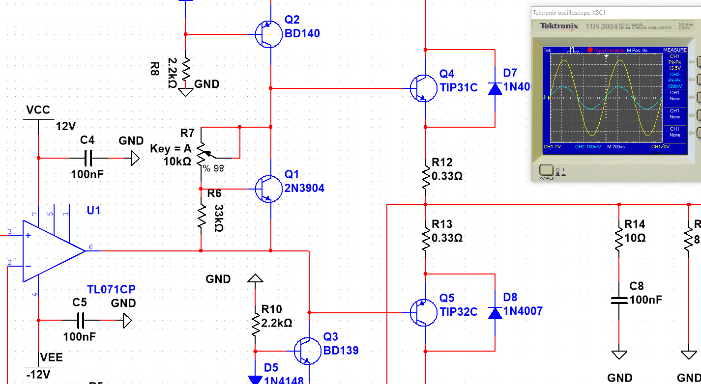
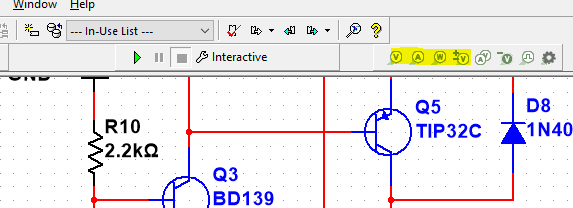
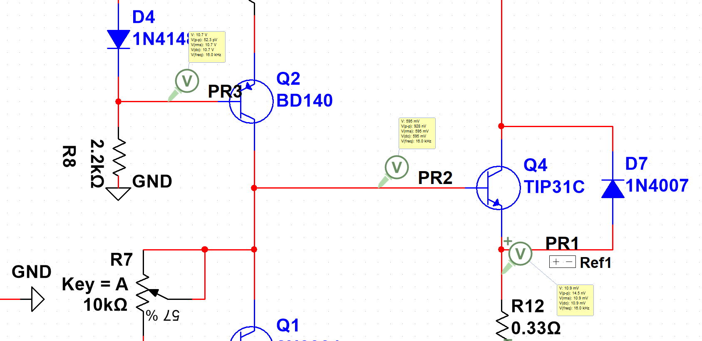
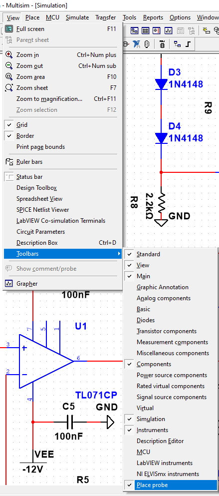

# Simulación en Multisim

Modelo de simulación del amplificador **AB**, desarrollado en **Multisim 14**. Se usa como banco de pruebas virtual: permite medir tensiones, corrientes y formas de onda antes de energizar el prototipo, y sirve como referencia para reparar y ajustar el equipo real.

## ¿Por qué se simuló?

Se optó por Multisim 14 por su biblioteca de instrumentos virtuales y su modo de simulación interactiva, que permiten trabajar como si se tuviera el equipo delante. La simulación cumple varias funciones dentro del proyecto:

- **Verificar el diseño antes de fabricar:** comprobar que la topología, el bias y la realimentación funcionan sin arriesgar componentes.
- **Medir sin riesgo:** observar todas las tensiones y corrientes del circuito sin conectar nada a 220 V.
- **Documentar el funcionamiento esperado:** dejar registrados los valores normales de cada etapa para compararlos con la placa real.
- **Probar modificaciones:** cambiar un resistor, un capacitor o un transistor y ver el efecto antes de tocar el PCB.
- **Apoyar la reparación:** si una placa no funciona, la simulación indica qué valor debería haber en cada nodo y ayuda a localizar la etapa fallada.

### Sonda de medición (Measurement Probe)

Es la forma más rápida de leer un punto del circuito. Muestra el valor de tensión, corriente, frecuencia o fase en el nodo donde se conecta, sin necesidad de cablear un instrumento completo.

**Cómo colocarla:**

1. Abrir [`Simulation.ms14`](../../Simulacion/Simulation.ms14).
2. Iniciar la simulación con **F5** o con el botón **Run** (triángulo verde).
3. En la barra de instrumentos, elegir **Measurement Probe** (el icono con forma de punta de prueba).

4. Hacer clic sobre el cable o nodo que se quiere medir. La sonda queda enganchada con un pequeño punto.

5. Leer el valor en el panel **Measurement Probe**, en la parte inferior de la ventana. Si no está visible, activarlo desde el menú **View→Ṯoolbars→P̲lace probe**.

| Documento | Archivo |
|---|---|
| Proyecto Multisim | [Simulation.ms14](../../Simulacion/Simulation.ms14) |
