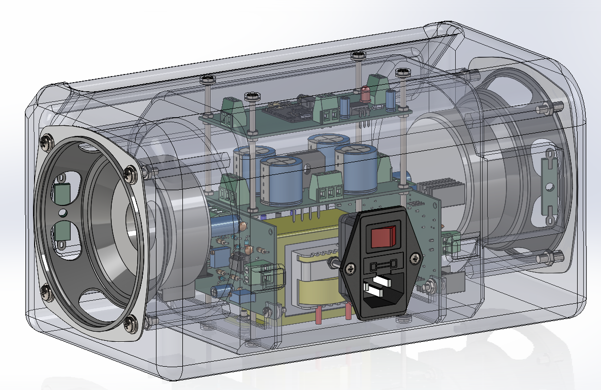
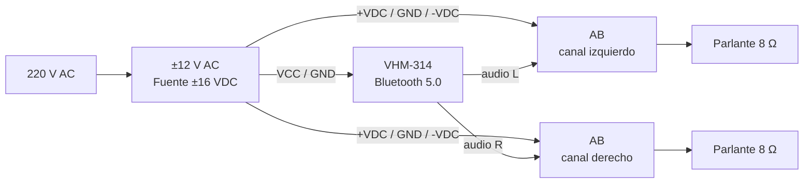

# JBR 



**JBR** es un parlante amplificado estéreo de diseño abierto. Combina dos etapas de potencia **clase AB** de 12 W sobre 8 Ω, una fuente lineal simétrica y un receptor **Bluetooth 5.0** (módulo [VHM‑314](docs/datasheet/VHM-314.pdf)), todo dentro de un gabinete impreso en 3D.

El repositorio reúne el diseño completo en **KiCad 9**, los planos de fabricación, el modelo 3D del gabinete, la simulación en **[Multisim](docs/markdown/simulation.md)** y el manual de usuario. Está pensado como proyecto educativo y como base reutilizable para otros amplificadores.

> [!WARNING]
> El equipo funciona con **220 V AC**. El interior del gabinete tiene tensiones peligrosas: no lo abras ni lo manipules conectado a la red. Las reparaciones y el primer encendido deben realizarse por un técnico.

## Contenido

- [Características](#características)
- [Arquitectura](#arquitectura)
- [Placas](#placas)
- [Estructura del repositorio](#estructura-del-repositorio)
- [Puesta en marcha](#puesta-en-marcha)
- [Fabricación](#fabricación)
- [Seguridad](#seguridad)
- [Créditos y contacto](#créditos-y-contacto)

## Características

| Característica | Valor |
|---|---|
| Configuración | Estéreo, 2 canales (2 placas AB) |
| Potencia | **2 × 12 W RMS @ 8 Ω**|
| Rieles de alimentación | ≈ ±16 VDC nominales (transformador 12‑0‑12 VAC) |
| Alimentación | 220 V AC, 50/60 Hz |
| Bluetooth | 5.0, módulo **[VHM‑314](docs/datasheet/VHM-314.pdf)** |
| Gabinete | 270 × 140 × 135 mm |
| Herramientas | KiCad 9.0, SolidWorks 2022, AutoCAD, Multisim 14 |

## Arquitectura



La fuente entrega tres salidas ±VDC: dos se usan para las etapas de potencia y una para el control. El módulo Bluetooth entrega las señales de audio izquierda y derecha a cada amplificador.

## Placas

| Placa | Función | Documentación | Esquemático |
|---|---|---|---|
| **AB** | Etapa de potencia clase AB, 12 W / 8 Ω (una por canal) | [AB](docs/markdown/ab.md) | [ABSchem](docs/PDF/Schem/ABSchem.pdf) |
| **Fuente x4** | Fuente simétrica ±16 VDC con tres salidas | [Fuente](docs/markdown/fuente.md) | [FuenteSchem](docs/PDF/Schem/FuenteSchem.pdf) |
| **Control** | Regulador 5 V, LED y conexión del módulo Bluetooth | [Control](docs/markdown/control.md) | [ControlSchem](docs/PDF/Schem/ControlSchem.pdf) |

También están disponibles las [transferencias para fabricación](docs/PDF/Transferencia), los [datasheets](docs/datasheet) y la [lista de materiales](docs/BOM.xlsx). El esquemático del amplificador está en [ABSchem](docs/PDF/Schem/ABSchem.pdf).

## Estructura del repositorio

```text
.
├── AB/                    # Proyecto KiCad de la etapa de potencia
├── Control/                  # Proyecto KiCad del control y Bluetooth
├── Fuente/                   # Proyecto KiCad de la fuente simétrica
├── gabinete/                 # Ensamble SolidWorks, STL para impresión 3D y STEP
├── Manual/                   # Manual de usuario en Word, fotos y video
├── Simulacion/               # Simulación del amplificador en Multisim
├── docs/
│   ├── BOM.xlsx              # Lista de materiales completa
│   ├── datasheet/            # Hojas de datos de los componentes principales
│   ├── img/                  # Fotos e imágenes de las placas y del equipo
│   ├── PDF/                  # Esquemáticos (Schem/) y transferencias por placa
│   └── markdown/             # Documentación técnica de cada placa
└── readme.md
```

## Puesta en marcha

1. **Revisar la fuente antes de conectar las placas.** Con el transformador conectado y sin carga, medir ±VDC entre cada riel y GND. Verificar también que no haya tensión AC en las salidas.
2. **Ajustar el bias de cada AB** con el amplificador sin señal y con la placa a temperatura de trabajo. Medir la caída sobre `R8` y `R9` (0,33 Ω) y ajustar `RV2` hasta obtener aproximadamente **10–15 mV** en cada resistencia (≈ 30–45 mA por par de salida). Ver [AB](docs/markdown/ab.md#ajustes).
3. **Ajustar la ganancia** con `RV1` (100 kΩ). Para una entrada típica de 1 V RMS, un valor cercano a 12 kΩ entrega la ganancia necesaria para la potencia nominal.
4. **Conectar el control** a una salida de la fuente y verificar los 5 V en la salida del [L7805](docs/datasheet/L7805.pdf) antes de colocar el módulo [VHM‑314](docs/datasheet/VHM-314.pdf).
5. **Vincular el Bluetooth**: encender el equipo y buscar el dispositivo **HFW-BT** desde el celular.

## Fabricación

- **Placas:** 100 × 50 mm, 2 capas, componentes de agujero pasante (THT). Los PDF de transferencia están en [`docs/PDF/Transferencia/`](docs/PDF/Transferencia).
- **Componentes:** la [BOM](docs/BOM.xlsx) está separada por placa ([fuente](docs/markdown/fuente.md), [AB](docs/markdown/ab.md), [control](docs/markdown/control.md), [gabinete](docs/markdown/case.md) y [accesorios](docs/markdown/case.md)). La BOM del AB corresponde a **un canal**; para el equipo estéreo hay que duplicarla.
- **Disipadores:** los [TIP31C](docs/datasheet/TIP31C.pdf)/[TIP32C](docs/datasheet/TIP32C.pdf) van sobre disipador TO‑220 y los [BD139](docs/datasheet/BD13X.pdf)/[BD140](docs/datasheet/BD13X.pdf) sobre disipador TO‑126. Usar grasa térmica y aislantes si el disipador queda unido al chasis.
- **[gabinete](docs/markdown/case.md):** piezas `abajo.STL` y `arriba.STL` en `gabinete/Impresion 3D/stl/` para impresión 3D, más el ensamble SolidWorks y las piezas STEP de las placas.
## Seguridad

- Conectar únicamente a **220 V AC, 50/60 Hz** con el cable C13 incluido.
- No abrir el gabinete con el equipo conectado. Los capacitores de la fuente pueden quedar cargados después de apagarlo: descargarlos con una resistencia antes de manipular.
- No cubrir el equipo ni apoyarlo sobre superficies blandas; los disipadores y el transformador se calientan.
- Evitar el uso prolongado a volumen máximo o con sonido distorsionado.
- Mantener lejos del agua y fuera del alcance de los niños.
- Reemplazar el fusible solo por otro del mismo tipo y valor, con el equipo **desconectado de la red**.

## Créditos y contacto

- **Autor:** Vittorio Coseglia
- **Repositorio:** [github.com/VittorioCoseglia/JBR](https://github.com/VittorioCoseglia/JBR)
- **Consultas y errores:** [abrir un issue](https://github.com/VittorioCoseglia/JBR/issues)
- **Correo:** vittorio.coseglia@gmail.com
